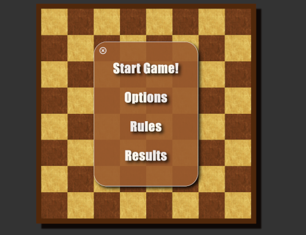
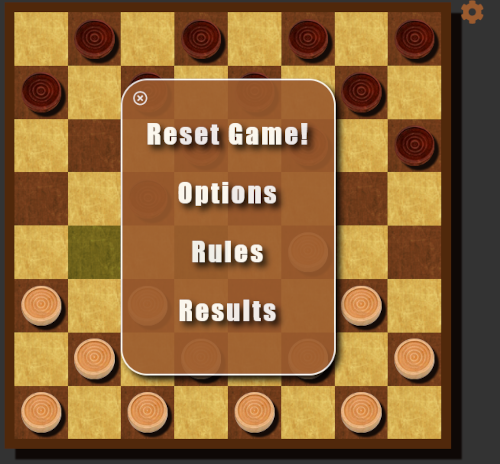
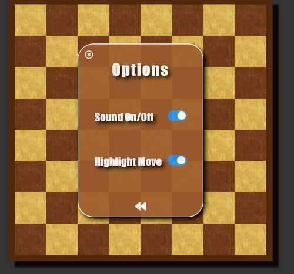
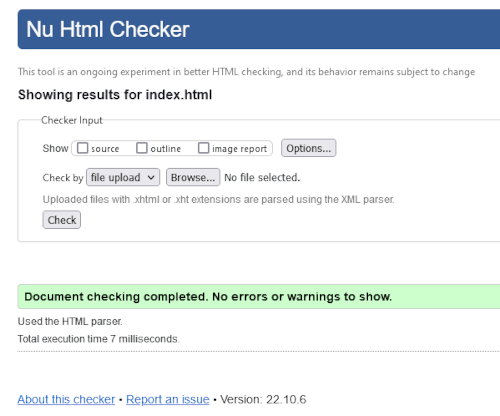
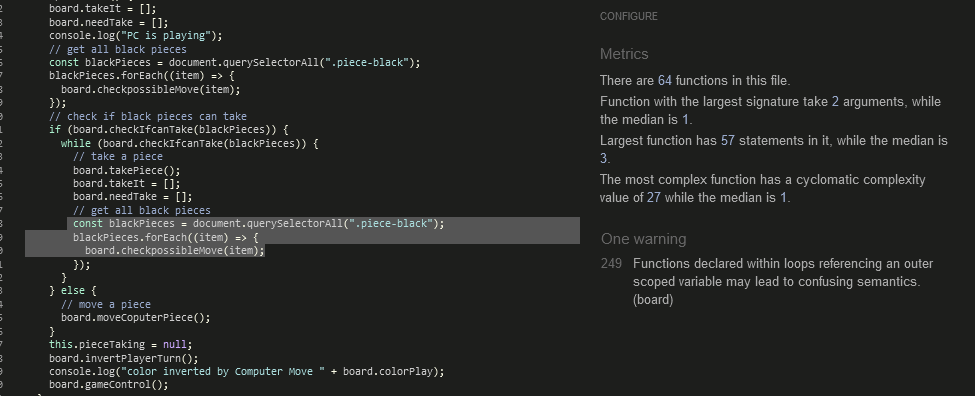

# Checkers Game

## Introduction

Checkers Game is played against the computer, with 8x8 British draughts or 10x10 International draughts. The objective is to capture all the opponent's pieces or block them so they cannot move. You can play as White or Black at three difficulty levels (Easy is the default). International draughts is the default ruleset, with 20 pieces per side, flying kings, backward man captures, and compulsory longest sequences. The interface is available in **English and French**.

The game logic is written in vanilla JavaScript (ES modules), and the interface in HTML and CSS. No build step or framework is needed.

<a href="https://cafalchio.github.io/checkers_game/" rel="noopener">Visit and play the live version of the game here</a>


The game can be played on any device, including small mobile phones down to about 250 x 300 px.

## Table of Contents

- [Checkers Game](#checkers-game)
  - [Introduction](#introduction)
  - [Table of Contents](#table-of-contents)
  - [UX](#ux)
  - [Technologies](#technologies)
  - [Architecture](#architecture)
  - [Features](#features)
    - [Main Menu](#main-menu)
    - [Computer Game Setup](#computer-game-setup)
    - [In-Game Menu](#in-game-menu)
    - [Options Menu](#options-menu)
    - [Rules Menu](#rules-menu)
    - [Results Menu](#results-menu)
    - [Game](#game)
    - [Saved Data](#saved-data)
  - [Testing](#testing)
  - [Known Issues and Rule Deviations](#known-issues-and-rule-deviations)
  - [Technical Debt](#technical-debt)
  - [Features Left to Implement](#features-left-to-implement)
  - [Deployment](#deployment)
  - [Credits](#credits)
  - [Acknowledgements](#acknowledgements)

## UX

- Site goals
  - Provide a fun and interactive game for the user to play.
  - Have a pleasant wood theme that is easy to use and navigate.
  - Have a responsive design that works on any device.
  - Have an intuitive menu.

- User goals
  - Play a quick game of checkers against the computer, with no sign-in.
  - Play on any device, in English or French.

## Technologies

- HTML: page structure.
- CSS: styling (`assets/css/style.css`, `assets/css/last-move.css`).
- JavaScript (ES modules): game logic, UI and AI.
- Font Awesome (loaded from CDN): menu icons.
- Node.js (dev only): dependency-free unit tests for the core modules.
- GitHub / GitHub Pages: version control and hosting.
- GIMP: image editing.

## Architecture

```
index.html
assets/js/
├── script.js            # UI layer: Board, Piece and Menu classes, computer AI, i18n strings
├── last-move.js         # Classic script: renders last-move highlight and captured "ghosts"
└── core/
    ├── rulesets.js      # RULESETS config (board size and rule flags), getBoardSize, getSquareCount
    ├── game-state.js    # GameState: serializable, DOM-free position
    └── rules-engine.js  # RulesEngine: captures, simple moves, mandatory capture, move validation
```

- **`rulesets.js`** is the single place where the two variants differ. Each ruleset is a frozen object with `boardSize`, `menCaptureBackward`, `flyingKings`, `longestCaptureMandatory` and `deferCapturedPieces`. International has all four flags on (10x10); British has them off (8x8).
- **`GameState`** holds plain board data (64 squares for British or 100 for International, `turn`, `ruleset`, a `revision` counter, `pendingCaptures` and `continuationSquare`), so it can later be sent over a network. `pendingCaptures` lists pieces already jumped in a multi-capture that are still on the board as blockers (International only). `continuationSquare` is the square of the piece that must keep capturing. `applyMove` checks state integrity and turn ownership, handles king promotion, removes captured pieces (immediately in British, at the end of the sequence in International), and rejects stale revisions.
- **`RulesEngine`** is stateless apart from the chosen ruleset. It decides what is legal. Public queries: `getCaptureOptions`, `getSimpleMoves`, `getMandatoryCaptures`, `getLegalMoves`, `validateMove`, `hasLegalMoves`. Internally it enumerates full capture paths (`getCapturePaths`) and derives the first-jump options from them (`getFirstCaptureOptions`), applying the longest-sequence filter when the ruleset requires it.
- **`script.js`** keeps the rendered DOM in sync with `GameState`. Every move goes through `Board.submitMove`, which validates, applies the move to the state, updates the DOM and dispatches a `checkers:move` event that `last-move.js` listens to.
- **Square numbering**: squares are indexed row-major from the top-left: 0-63 for British, 0-99 for International. Black starts at the top (three rows in British, four in International), White at the bottom. White always moves first.

## Features

### Main Menu

The first screen asks you to choose a game mode:

- **Against computer** (available).
- **Against local player** and **Against online player** (disabled, marked "coming soon").

A footer gives access to **Options**, **Rules** and **Results**.



### Computer Game Setup

After choosing "Against computer", you configure the game and press **Start Game!**:

- **Play as**: White or Black. If you choose Black, the computer moves first.
- **Difficulty**: Easy (default), Medium or Hard.
- **Rule set**: International draughts (default) or British draughts.

Difficulty and ruleset are remembered for next time. The chosen colour is not. Changing the ruleset rebuilds the board straight away; the pieces are placed when you press Start.

### In-Game Menu

Once a game is running, the small cog button opens a menu with **Restart**, **Rules** and **Results**. Restart reloads the page. The menu closes when you click outside it or press its close icon. Options (language, highlight) are only reachable from the main menu, before a game starts.



Two always-visible buttons control **sound** (off by default) and **fullscreen**.

### Options Menu

- **Forced capture highlight**: highlights the pieces that must capture (on by default, not saved between sessions).
- **Language**: English or French. The initial language follows the browser preference (French when French is preferred, otherwise English). The choice is saved.



### Rules Menu

Shows the rules for the currently selected ruleset, in the selected language. Only the "King" paragraph differs between British and International. The text can be scrolled.


### Results Menu

Shows the number of games won by the player and by the computer, with a button to reset both. Results are stored in the browser's local storage. Draws are not tracked (see [Known Issues](#known-issues-and-rule-deviations)).


### Game


- British: 8x8 board with 12 pieces per side. International: 10x10 board with 20 pieces per side.
- Move by **click** (select a piece, then a highlighted square) or by **dragging** (pointer events, so it works with mouse and touch).
- **Captures are mandatory.** A multi-capture is played one jump at a time with the same piece. International captures must use the longest available sequence; captured pieces remain as blockers and are removed when the sequence ends. British captures do not have to be the longest, and captured pieces are removed immediately. The computer also shows each jump before continuing.
- A piece reaching the last row becomes a king. In International draughts kings are "flying" (move and capture any distance) and men may capture backward. In British draughts kings move one square and men capture forward only.
- The last move is highlighted, and the pieces captured by it are shown as faint "ghosts" until the next move. While a multi-jump is in progress, the previous turn and the jumps made so far are both shown.
- Captured pieces are collected in trays beside the board.
- A game-over dialog announces the winner (no pieces left, or no legal moves) and returns to the menu (by reloading the page).
- The computer plays with a random "thinking" delay that is shorter on higher difficulties (roughly 1.8-3.8 s on Easy, 1.2-2.5 s on Medium, 0.55-1.25 s on Hard), plus 0.5 s between the jumps of a multi-capture.

| Difficulty | Quiet moves | Captures |
| --- | --- | --- |
| Easy | Random legal move | Random legal capture |
| Medium | Heuristic, but random 35% of the time | Heuristic, but random 35% of the time |
| Hard | Always the best-scoring move | Always the best-scoring capture |

The heuristic is a one-move scoring function: advancement (x2), mobility of the moved piece (x2), distance from the centre, a +80 promotion bonus, and penalties for leaving pieces capturable (-100 if the moved piece itself can be captured, -10 for each other capture the opponent gets). It does not search future turns.

### Saved Data

Stored in the browser's `localStorage`:

| Key | Meaning |
| --- | --- |
| `language` | `en` or `fr` (written only once the user changes it) |
| `ruleset` | `international` or `british` |
| `difficulty` | `easy`, `medium` or `hard` |
| `soundEnabled` | `"true"` or `"false"` |
| `whiteScore` | Games won by **the player** (regardless of colour) |
| `blackScore` | Games won by **the computer** (regardless of colour) |

## Testing

The core state and rules modules have dependency-free Node unit tests:

```bash
npm test
```

The browser E2E test covers ruleset selection, starting an International game, and opening its Rules screen without losing the board:

```bash
npx playwright install chromium
npm run test:e2e
```

There are no automated tests for the AI, drag-and-drop, menus or `last-move.js`.

Validation (screenshots may predate the current code and should be re-run, see [Technical Debt](#technical-debt)):

- W3C HTML validation:

  

- Jigsaw CSS validation:

  

- JSHint:

  

- Lighthouse mobile and desktop:

  

  

## Known Issues and Rule Deviations

User-visible behaviour that differs from what players, or the in-game rules text, may expect. Items marked *(from code review)* were found by reading the code and have not been reproduced in play.

**Rules**

- **No draw detection.** The rules text promises a draw "after 30 moves by kings without a capture" and when "neither side can force a win", but `checkWinner` only detects "no pieces" and "no legal moves". Two kings can shuffle forever, and the results screen has no draw counter. *Either implement it or remove the sentence from both translations.*
- **Promotion in the middle of a capture** *(from code review)*. `getCapturePaths` stops a path as soon as a man lands on the last row. That is correct for British draughts, but in International draughts a man that can keep capturing from that row must continue as a man and is only promoted if the sequence ends there. In addition, `submitMove` decides whether the turn continues *after* the provisional move has already promoted the piece, so a newly promoted piece can keep capturing as a king in both rulesets, which British rules do not allow.
- **The Rules text is generic.** It does not mention that International men may capture backward, and the same simple-move and jump paragraphs are shown for both rulesets.
- International multi-captures are performed one jump at a time. Captured pieces stay on the board as blockers until the sequence finishes, then are removed together as required by the rules.

**Game**

- **Blocked-side check** *(from code review)*. `checkWinner` counts legal moves for both colours at the start of every turn, not only for the side to move. A side that is blocked at that moment can be declared the loser even though the opponent's move would have freed it. It should evaluate only the player whose turn it is.
- The computer uses a shallow one-move heuristic (Medium, Hard) or random choices (Easy). It does not search future turns, so it is easy to beat on tactics.
- It was reported to crash on Android, but I was not able to reproduce it. Likely suspects are listed in [Technical Debt](#technical-debt) (unguarded `localStorage`, uncaught `throw`s inside timers, unhandled `Audio.play()` rejections).
- "Restart" and "OK" after game over both call `location.reload()`, so there is no in-place restart and the chosen colour is lost.
- Changing language during a game is not possible (Options is not in the in-game menu), and only the turn message is re-translated when it is.
- Before a game starts, the close (x) icon on the Options, Rules and Results screens does nothing, because `closeMenu` only works while a game is running. Use the back control instead.

## Technical Debt

Ordered roughly by risk. "Where" points to the relevant code.

### High

| # | Debt | Where | Suggested fix |
| --- | --- | --- | --- |
| 1 | **Unguarded `localStorage`**: reads and writes are not wrapped in `try/catch`. In private modes or with blocked storage the constructor throws and the game never loads. This is a plausible cause of the Android crash. | `Board` constructor, sound toggle handler, `setLanguage`, `setRuleset`, `setDifficulty`, `updateScore`, `Menu.results` | Small `storage` helper with `try/catch` and in-memory fallback. |
| 2 | **Uncaught `throw` inside timers**: `submitMove` and `scoreComputerMove` throw when the DOM and state disagree. They run from `setTimeout` callbacks, so one inconsistency freezes the game silently. | `submitMove`, `scoreComputerMove`, `computerMove` | Catch at the `computerMove` boundary, log, and recover or show a message. |
| 3 | **Two sources of truth**: `GameState` plus `pieceElements`, `piecePositions` (WeakMap), expando properties on DOM nodes (`piece.movable`, `piece.suppressClick`), and the `needTake` / `takeIt` arrays. They must be kept in sync by hand. | `Board` | Render the DOM from `GameState` in one `render()` function; derive "movable" and capture lists from the `RulesEngine` on demand. |
| 4 | **Rules text and code disagree** (draw rule, mid-capture promotion; see Known Issues). | `translations`, `checkWinner`, `getCapturePaths`, `submitMove` | Implement or remove the draw rule; make promotion happen only when a sequence ends (International) and end the turn on promotion (British). |
| 5 | **UI coverage is limited to a Playwright smoke flow**, and `script.js` is one file of well over 1,000 lines mixing i18n data, board rendering, AI, drag handling and menus. | `script.js` | Split into modules (`i18n.js`, `ai.js`, `board-view.js`, `menu.js`); move the AI to a pure function over `GameState` so it can be unit tested. |

### Medium

| # | Debt | Where | Suggested fix |
| --- | --- | --- | --- |
| 6 | **Global singleton coupling**: `Piece`, listeners and timers reference the global `board` (declared after the classes). Listeners are shared functions (`pieceClick`, `movePiece`) that use `board` instead of `this`. | `Piece.get_piece`, `pieceClick`, `movePiece`, `gameControl` | Pass the board in, or bind handlers. |
| 7 | **Implicit event ordering**: `submitMove` dispatches `checkers:move` *before* it moves captured pieces in the DOM, and `last-move.js` throws if the captured piece is already gone (the error is reported but not propagated, so the highlight history can end up half-updated). | `submitMove`, `last-move.js` | Include the captured piece colour/king flag in the event detail, or dispatch after rendering. |
| 8 | **Duplicate AI paths**: `takePiece` and `moveComputerPiece` each implement the random-vs-heuristic choice. Magic numbers (0.35, the delay ranges, the 2/2/80/100/10 score weights) are inline. | `takePiece`, `moveComputerPiece`, `scoreComputerMove`, `gameControl` | One `chooseMove(candidates, difficulty)` plus a `DIFFICULTY` config object. |
| 9 | **Fragile capture bookkeeping**: `takeIt` entries are `[piece, captured, landing]` tuples built as a side effect of `checkpossibleMove`, which also returns moves and mutates `needTake`. | `checkpossibleMove`, `checkIfcanTake`, `getComputerCaptures` | Make it a pure query on `RulesEngine`. |
| 10 | **Misleading score keys**: `whiteScore` / `blackScore` actually mean player / computer, and `updateScore` has an unreachable null branch (and does nothing if the key is missing). | `updateScore`, `Menu.results` | Rename (with a one-time migration) to `playerWins` / `computerWins`. |
| 11 | **Timers are never cancelled** (computer move, `checkWinner`, 3 s fullscreen error). "Restart" works only because it reloads the page. | `gameControl`, `toggleFullscreen` | Track timer ids; clear on restart. |
| 12 | **Checking for a winner on a 1 s timer** after every turn, and `checkWinner` counts *moves* in variables called `...PiecesLeft`. | `checkWinner` | Check right after each move, only for the side to move, and rename variables. |
| 13 | **Accessibility**: the close and back controls (`#close-menu`, `#rules-back`) are `<div>` icons (not focusable or keyboard operable); the game-over dialog does not trap focus or close on Escape; pieces and squares are `<div>`s, so the board is not keyboard playable. | `Menu.*`, `showGameOver` | Use `<button>`s with labels; add keyboard controls. |
| 14 | **Cache versioning**: one `APP_VERSION` global in `index.html` currently patches the CSS and JS URLs. A build or hashed filenames would reduce repeated manual setup. | `index.html`, `script.js`, core modules | Keep the global version and use hashed filenames or a build step for stronger cache guarantees. |

### Low (cleanup)

- **Dead code**: `whiteKing`, `blackKing`, the `this.turn` counter, `removeMoving()` (registers another `movestart` listener on every start), the `CheckersRules` alias, `RulesEngine.getCaptureMoves`, `hasLegalMoves` (unused in `script.js`, which re-implements it in `checkWinner`), `Piece.color`, and `Board.setRuleset`'s in-game branch plus everything after it (the setup menu is only shown before a game, so `isPlaying` is always false there and the method always returns early).
- **Stale 8x8 constants**: `rules-engine.js` still exports `BOARD_SIZE = 8` and `SQUARE_COUNT = 64` and defines unused `inBounds` / `squareAt` helpers. These are wrong for International draughts and should be removed. The exported `getLegalMoves` and `validateMove` wrapper functions are also unused by `script.js`.
- **Unused translation keys**: `chooseColor` and `sound`. The `*WinsPieces` and `*WinsMoves` strings are identical in each language.
- **Latent bug**: `playSound("notify")` references `this.notify`, which is never created.
- **Unhandled promise rejections**: `Audio.play()` is not awaited or caught (autoplay restrictions). All three audio files are created eagerly at start-up.
- **`/*jshint esversion: 6 */` is outdated**: the code uses object spread (ES2018), `async/await` (ES2017) and ES modules. Update the config and re-run JSHint; the README screenshot is likely stale.
- **Font Awesome is loaded twice**, as v4.7 CSS and v5.0.6 JS from two different CDNs, and the menu mixes `fa` and `far` classes. Neither include has SRI. Pick one version, preferably self-hosted.
- **Manual cache-busting**: version `0.23` is centralized in the `APP_VERSION` global in `index.html`; page resources are rewritten with that value at load time.
- **Leftover template metadata** in `index.html`: `author` / `copyright` mention "247games LLC", and `X-UA-Compatible` (IE) is obsolete. Confirm they are intended.
- **Naming and typos**: `plyerScore`, `get_piece`, `checkpossibleMove` (mixed styles). The `#options` id is reused for the title of the Rules screen, and `#rules-back` for the back control of the Results screen.
- **Screenshots** in `assets/images` show the old menu layout (single menu with Start/Options/Rules/Results). Retake them.
- **Dependence on `package.json`**: the tests and the `type: "module"` setting are not verified in this review. Make sure they are committed and that CI (e.g. a GitHub Action) runs `npm test`.

## Features Left to Implement

- Implement a better AI for the computer (look-ahead search such as minimax with alpha-beta, plus a proper evaluation).
- Draw detection and a draw counter in Results.
- Local two-player mode (the menu button is already in place but disabled). `GameState` was designed to be serializable, which also prepares for an online mode.
- A timer to limit the time of each player.
- A smoother animation for the pieces moving.
- Persist player colour and the highlight option.
- Option to undo a move or review the move history.

## Deployment

- The game is deployed on GitHub Pages directly from the repository. Pages is a static host and no build step is required. Because the entry script is an ES module, the game must be served over HTTP(S) (not opened via `file://`).

## Credits

- Stack Overflow
- Guido, my mentor
- w3Schools
- This channel that teaches checkers: https://www.youtube.com/watch?v=WD3NTNQElew
- developer.mozilla.org (where I spent most of my time)

## Acknowledgements

- My mentor for saving me from starting in a wrong way, which would have made the project impossible to finish.
- My colleagues on the Slack channel.
- The tutors for their help.
- My last hackathon team, which tested the game and gave great feedback.
